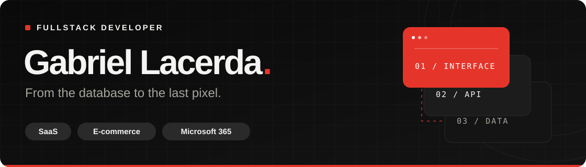

  

  
  

### Building products that people use.

I'm a senior full stack engineer based in **Brazil**, working with **international teams**. Since 2021, I've built SaaS platforms, e-commerce and subscription products, and enterprise applications, from requirements to production.

**My focus:** TypeScript, Node.js, React and Next.js, with event-driven backends on Azure, dependable APIs, and integrations that hold up in production.

### My everyday stack

  

**Also:** Express · NestJS · tRPC · Redis · WebSockets · MongoDB · MySQL · Astro · Shopify · Stripe · GitHub Actions · Jest · Playwright · SPFx · Power Automate

### A few things I've shipped

| Product | What I built |
| :--- | :--- |
| **Creator subscription platform** | Event-driven microservices on Azure (Service Bus, Functions) with Redis and WebSockets: real-time chat, notifications, in-app purchases, and bulk messaging. |
| **Shopify sales page in Astro** | Rebuilt a sales page and cut checkout load time from **12s to 3s** (75% faster). |
| **Financial education SaaS** | Subscription product with tRPC, MySQL, Clerk, and Stripe that reached about **10 paying subscribers** in its first two weeks. |
| **Subscription management** | Shopify, Loop Subscriptions, and CheckoutChamp integrations with passwordless authentication. |
| **Itaipu Binacional** | Interactive org chart in three languages for **3,000+ employees** in Brazil and Paraguay, connected to SharePoint and Azure AD. |
| **Automated transcription** | An AssemblyAI platform that turned 5–6 hours of manual work into 1–2 hours of review (**about 70% less time**). |

<b>A little more about me</b>

- **Experience:** Peak One Dev · SharePrime · K2M Soluções · Agência Nambbu.
- **Approach:** direct client communication in English, code review, automated tests, and AI-assisted development (Claude Code, Cursor).
- **Mentoring:** trained interns and developers at each of my last three companies.
- **Languages:** Portuguese (native), English (advanced), Spanish (basic).

---

**Have something in mind? Let's build it together!**
